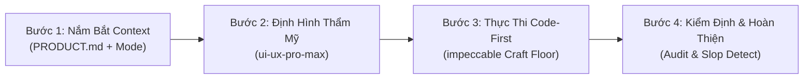

# AGENTS.md — Hướng Dẫn Vận Hành AI Agent Cho Dự Án TechCare Pro

Tài liệu này định nghĩa nguyên tắc làm việc và quy trình phối hợp giữa 2 skill thiết kế chuyên sâu đã được tích hợp trong dự án:
1. **`ui-ux-pro-max`** (Kho tri thức & Trí tuệ thiết kế UI/UX)
2. **`impeccable`** (Quy trình giám sát, Kiểm chuẩn chất lượng & Chống AI Slop)

Mọi AI coding agent khi tham gia phát triển, sửa lỗi hoặc nâng cấp giao diện trong codebase này **BẮT BUỘC** tuân thủ hướng dẫn dưới đây.

---

## 1. Phân Vai & Cơ Chế Phối Hợp Giữa 2 Skill

| Tiêu chí | `ui-ux-pro-max` | `impeccable` |
| :--- | :--- | :--- |
| **Vai trò cốt lõi** | **"Thiết kế cái gì?"** (Knowledge Base) | **"Triển khai & Kiểm định thế nào?"** (Design Director) |
| **Trách nhiệm** | - Tra cứu phong cách UI, bảng màu, cặp font.<br>- Cung cấp mẫu component, biểu đồ, vi tương tác.<br>- Đảm bảo phù hợp ngữ cảnh doanh nghiệp (SaaS, Tech Repair). | - Thiết lập kỷ luật chất lượng sàn (Craft Floor).<br>- Loại bỏ hoàn toàn "AI slop" (màu tím/xanh nhạt nhẽo, card lồng card, bo góc quá đà).<br>- Audit kỹ thuật (a11y, contrast, responsive, edge cases). |
| **Vị trí tài nguyên** | `.agents/skills/ui-ux-pro-max/` | `.agent/skills/impeccable/` |
| **Công cụ tương tác** | Tra cứu dữ liệu CSV/JSON, quy chuẩn thiết kế. | Lệnh `/impeccable <verb>`, script `impeccable.cmd detect`. |

---

## 2. Quy Trình Chuẩn 4 Bước Khi Xây Dựng / Cải Tiến Giao Diện



### Bước 1: Nắm Bắt Context & Xác Định "Mode" Giao Diện
Trước khi viết code, đọc [PRODUCT.md](PRODUCT.md) để nắm rõ 5 phân hệ người dùng (Admin, KTV, Sale, Kho, Khách hàng) và xác định đúng **Mode** theo chuẩn Impeccable:
- **Mode `Operate`** (*Admin, KTV Workspace, Kho, Sale Workspace*):
  - Ưu tiên tối đa tính scanable, mật độ thông tin cao, thao tác nhanh, độ tương phản sắc nét.
  - Tuyệt đối không đưa các hiệu ứng animation rườm rà làm chậm thao tác kỹ thuật viên.
- **Mode `Persuade` / `Read`** (*Trang chủ, Bảng giá `services.html`*):
  - Nhấn mạnh tính minh bạch, niềm tin dịch vụ, bảng giá rõ ràng, Call to Action dứt khoát.
- **Mode `Customer-Centric`** (*Tra cứu tiến độ `tracking.html`, Cổng khách hàng `user/`*):
  - Tối ưu hoàn hảo cho Mobile (responsive), timeline trạng thái trực quan, nút bấm lớn dễ chạm (&ge; 44x44px).

### Bước 2: Lựa Chọn Thẩm Mỹ & Thành Phần (Dùng `ui-ux-pro-max`)
Sử dụng kho dữ liệu của `ui-ux-pro-max` để chọn thông số thiết kế chuẩn:
- **Bảng màu (Product Palette):**
  - Ngành dịch vụ kỹ thuật / bảo hành: Tông xanh công nghệ (Blue/Navy), xám chuyên nghiệp (Slate/Neutral) kết hợp màu nhấn cảnh báo chuẩn (Success: Emerald, Warning: Amber, Danger: Rose).
  - Tránh tuyệt đối các dải chuyển màu tím gradient ngẫu nhiên của AI.
- **Font chữ (Typography):**
  - Ưu tiên font hỗ trợ tiếng Việt hoàn hảo: `Plus Jakarta Sans`, `Inter`, `Be Vietnam Pro`.
  - Phân cấp rõ rệt: Heading (Bold, letter-spacing âm nhẹ), Body (Regular, line-height 1.5–1.6), Meta/Status (Medium, uppercase 11–12px).
- **Component Patterns:**
  - Tra cứu cấu trúc component chuẩn: bảng dữ liệu kèm bộ lọc, thẻ tóm tắt KPI (Bento Grid nhẹ), timeline trạng thái 5 bước (Tiếp nhận &rarr; Chẩn đoán &rarr; Báo giá &rarr; Sửa chữa &rarr; Trả máy).

### Bước 3: Triển Khai Code Sạch Theo Sàn Chất Lượng (Dùng `impeccable Craft Floor`)
Khi viết HTML/CSS/JS, tuân thủ nghiêm ngặt các điều cấm kỵ chống "AI Slop":
1. **Không tạo khoảng trống vô nghĩa:** Padding và margin phải tuân theo thang chuẩn (4px, 8px, 12px, 16px, 24px, 32px).
2. **Không card-in-card lặp đi lặp lại:** Thay vì lồng nhiều lớp thẻ viền xám, dùng phân cách bằng whitespace hoặc background tint nhẹ.
3. **Typography có mục đích:** Không để chữ xám mờ trên nền xám nhạt (tỷ lệ tương phản phải đạt WCAG AA &ge; 4.5:1).
4. **Bảo toàn kiến trúc dự án:**
   - Client-side thuần (HTML5, Vanilla CSS3, JS ES6+).
   - Bảo toàn cơ chế bảo mật: *Zero-Flash Session Caching* và *Page Authorization Guard*.
   - Tích hợp đúng SDK Firebase Firestore và Authentication.

### Bước 4: Kiểm Định Kỹ Thuật & Tẩy Slop (Dùng `impeccable Audit & Detect`)
Sau khi viết xong code:
1. **Chạy Slop Detector tự động:**
   ```powershell
   .\.agent\skills\impeccable\scripts\impeccable.cmd detect <đường_dẫn_file>
   ```
   Kiểm tra xem có vi phạm quy tắc thiết kế cơ học nào không (màu contrast thấp, font size bất thường, touch target quá nhỏ).
2. **Đánh giá UX Heuristics:**
   Chạy `/impeccable critique <tên_trang>` để chấm điểm luồng trải nghiệm người dùng.
3. **Kiểm tra kỹ thuật hoàn thiện (Harden):**
   - Đã xử lý trạng thái Loading (Skeleton / Spinner) khi Firebase đang nạp dữ liệu chưa?
   - Đã có Empty State (khi danh sách vé/linh kiện trống) chưa?
   - Form đã có validation tiếng Việt rõ ràng, báo lỗi cạnh input chưa?
   - Giao diện có co giãn mượt trên màn hình điện thoại (375px - 430px) chưa?

---

## 3. Sổ Tay Lệnh Nhanh (Cheatsheet Cho Agent)

| Nhu cầu của người dùng | Hành động của Agent |
| :--- | :--- |
| **"Tạo / Thiết kế lại trang mới"** | 1. Đọc [PRODUCT.md](PRODUCT.md)<br>2. Chọn layout & palette từ `ui-ux-pro-max`<br>3. Áp dụng sàn chất lượng `impeccable craft-floor` để code<br>4. Chạy `impeccable.cmd detect` |
| **"Đánh giá UX trang X"** | Kích hoạt `/impeccable critique <file>` |
| **"Kiểm tra lỗi giao diện, a11y, responsive"** | Kích hoạt `/impeccable audit <file>` |
| **"Giao diện trông thô / xấu / quá đơn điệu"** | Tham khảo style từ `ui-ux-pro-max` + gọi `/impeccable bolder` hoặc `/impeccable polish` |
| **"Giao diện quá rối, lòe loẹt, chật chội"** | Kích hoạt `/impeccable quieter` hoặc `/impeccable distill` để dọn dẹp visual noise |
| **"Cập nhật tài liệu thiết kế chung"** | Chạy `/impeccable document` để quét toàn bộ CSS và tạo/cập nhật `DESIGN.md` |

---

## 4. Ràng Buộc Bất Biến (Non-Negotiables)
- **Không tự ý đổi kiến trúc:** Dự án dùng Vanilla HTML/CSS/JS + Firebase. Không tự ý cài đặt thêm framework nặng (React, Angular, Vue) trừ khi được người dùng yêu cầu rõ ràng.
- **Tiếng Việt chuẩn xác:** Mọi nhãn nút, thông báo lỗi, trạng thái đều viết bằng Tiếng Việt chuẩn mực, đúng thuật ngữ bảo hành máy tính (ví dụ: *Tiếp nhận*, *Chẩn đoán*, *Báo giá*, *Tồn kho*, *Linh kiện*).
- **Giữ vững phân quyền:** Mọi can thiệp giao diện không được làm phá vỡ logic kiểm tra `allowedRoles` và điều hướng an toàn trong `js/auth.js` / session guard.
